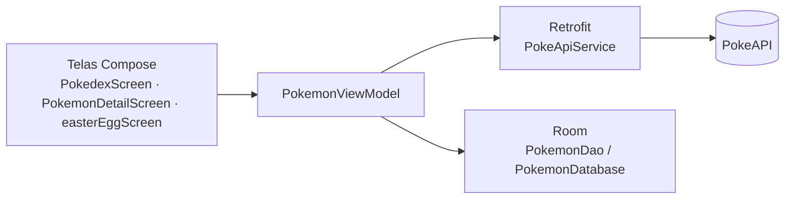

# Pokédex — Android com Jetpack Compose

Aplicativo Android de **Pokédex** desenvolvido na disciplina de **PWM**. Ele consome a [PokeAPI](https://pokeapi.co), guarda os dados localmente com **Room** para funcionar offline e tem um minijogo "Quem é esse Pokémon?".

## Funcionalidades

- **Lista de Pokémon** com número, nome e imagem, carregada da PokeAPI com paginação (`limit`/`offset`)
- **Tela de detalhes** com tipos e descrição (*flavor text*) da espécie
- **Cache local** com Room: depois do primeiro carregamento, a lista abre sem internet
- **Minijogo "Quem é esse Pokémon?"**: mostra a silhueta de um Pokémon aleatório e três opções de resposta
- Botão de recarregar e navegação entre telas com Navigation Compose

## Arquitetura

| Camada | Pacote |
|---|---|
| Interface (Compose + Material 3) | `Screens/`, `ui/theme/` |
| Estado e regras | `viewmodel/` (`PokemonViewModel`, `PokemonViewModelFactory`) |
| Rede | `data/network/` (Retrofit + Gson) |
| Persistência | `DataBase/` (Room: entidade, DAO, conversores) |
| Modelos | `data/model/` |

## Como executar

1. Abra a pasta no **Android Studio** (Koala ou mais recente).
2. Aguarde o Gradle sincronizar.
3. Rode em um emulador ou celular com Android 7.0 (API 24) ou superior.

## Tecnologias

Kotlin · Jetpack Compose · Material 3 · Navigation Compose · ViewModel · Coroutines · Retrofit · Gson · Room · Coil

---

Feito por [João Pedro Pimenta](https://www.linkedin.com/in/joao-pedro-pimenta/) durante a graduação em Ciência da Computação na UNICAP.
